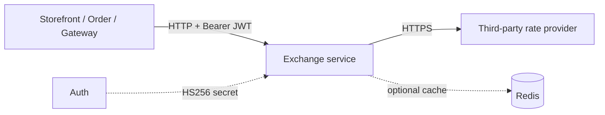

# Architecture

## Responsibilities

| Component | Owns |
| --- | --- |
| `api` | HTTP boundary, currency validation, status codes and the stable error envelope. |
| `services` | Cache single-flight, provider orchestration and response shaping. |
| `providers` | Provider adapter, retries, timeout mapping and payload normalization. |
| `domain` | Currency validation and internal rate models. |
| `cache` | Redis rate cache protocol and degraded behavior. |
| `observability` | Request IDs, Prometheus metrics and structured logging. |

Exchange has no database. It owns only the HTTP contract and the provider
integration. Other platform services call Exchange; Exchange never calls them.

## Request flow

1. `RequestIdMiddleware` accepts or creates `X-Request-Id` and binds it to the log
   context.
2. `MetricsMiddleware` records HTTP latency and status for contract routes.
3. `JwtAuthenticator` validates the HS256 bearer token and extracts the account UUID
   from `sub`.
4. The route validates the two currency codes with a three-letter pattern.
5. `ExchangeService` normalizes the currencies, consults the cache when enabled and
   otherwise calls the provider.
6. The provider adapter normalizes the payload into `ProviderRate`.
7. The response is shaped into `ExchangeRate` with `sell`, `buy`, a UTC `date` and
   `id-account`.
8. `ApiExceptionHandler` converts domain and provider failures into stable JSON
   errors.

## Provider boundary

`HttpExchangeProvider` is the only component that talks to the provider. It:

- builds the request URL and optional bearer credential;
- enforces connect/read timeouts;
- retries only timeouts, transport errors and `408`/`425`/`5xx`;
- caps concurrent provider calls per instance;
- maps every provider outcome to a stable `ApiError`.

The provider payload is never forwarded to clients, so provider changes do not
break the platform contract.

## Availability

- Liveness reflects the process only.
- Readiness requires a configured provider. When the cache is enabled and Redis is
  unreachable, readiness reports `DEGRADED` but continues to serve from the
  provider.
- Redis is optional. Cache outages are cache misses, never request failures.
- Stale rates are never served; the contract has no stale-data allowance.

## Related decisions

- [API and errors](api.md)
- [Provider adapter](provider.md)
- [Cache and resilience](cache.md)
- [Observability](observability.md)